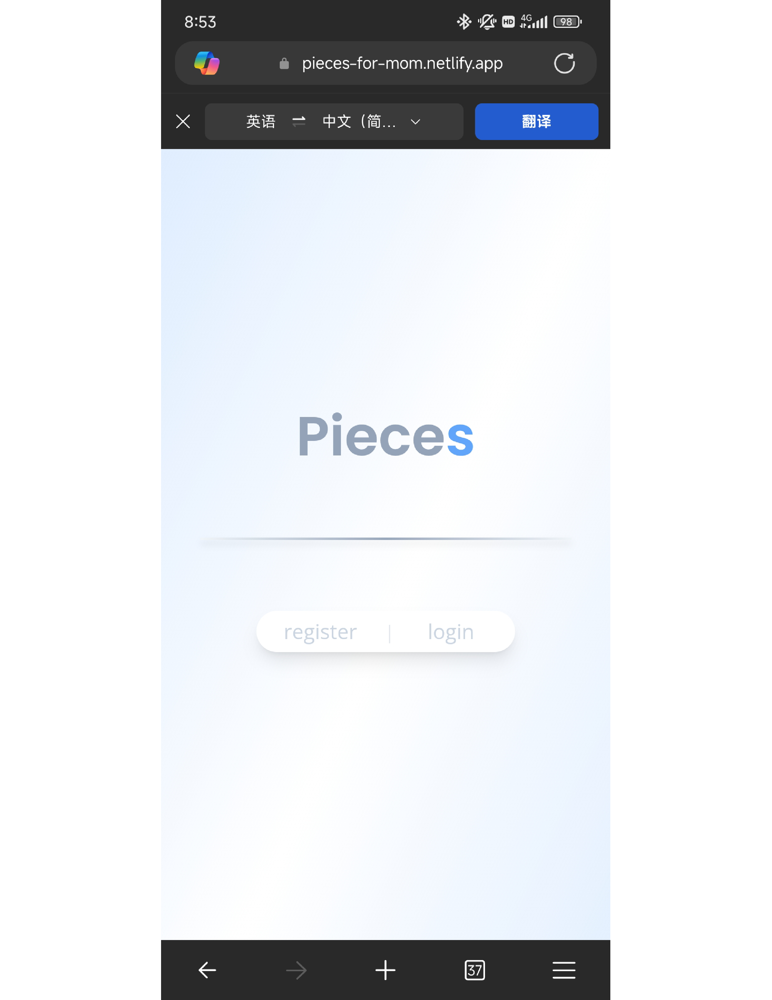
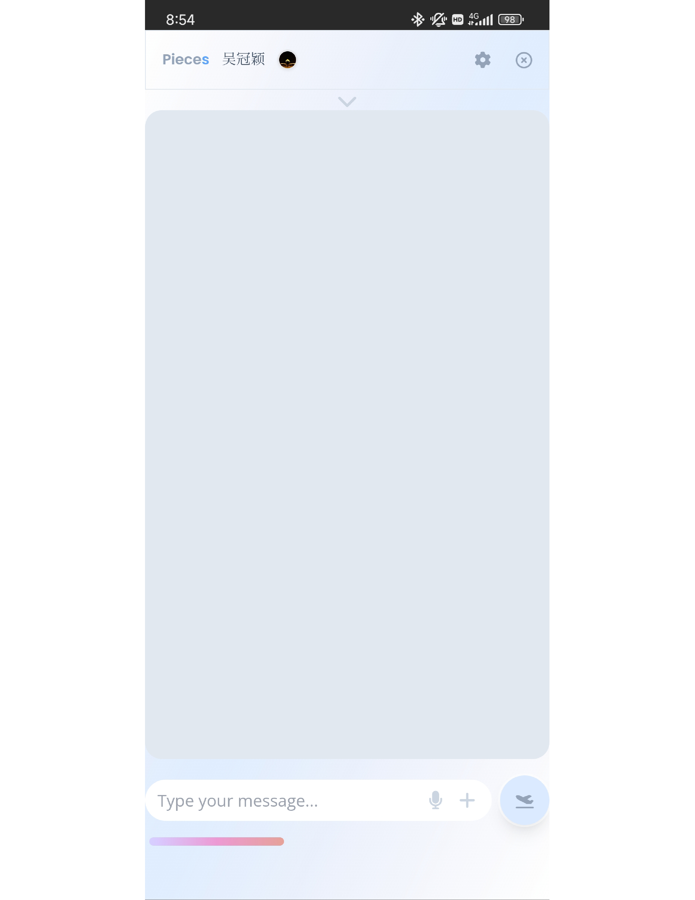
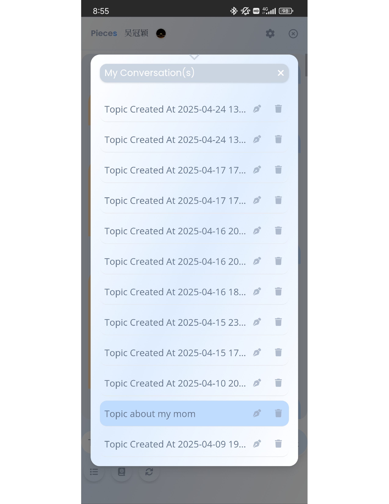
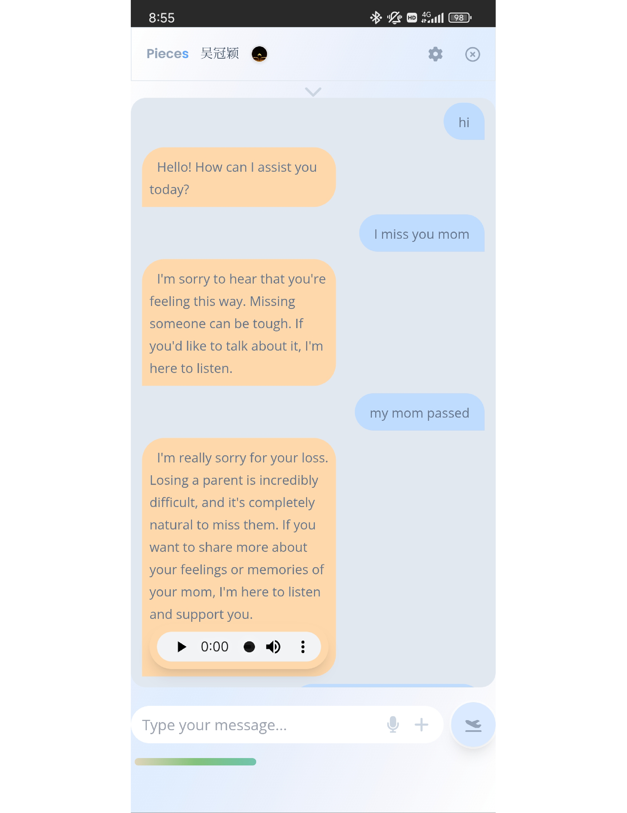
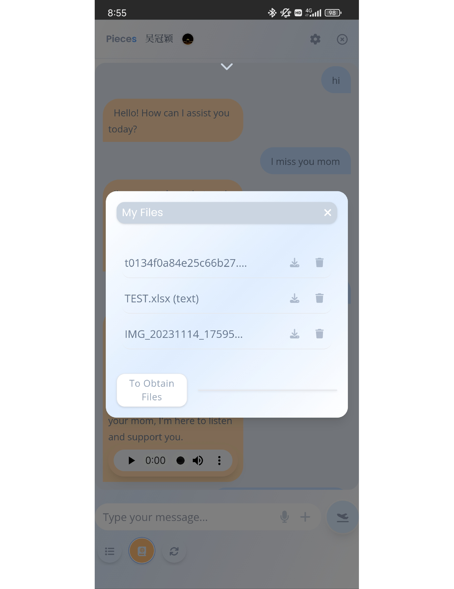
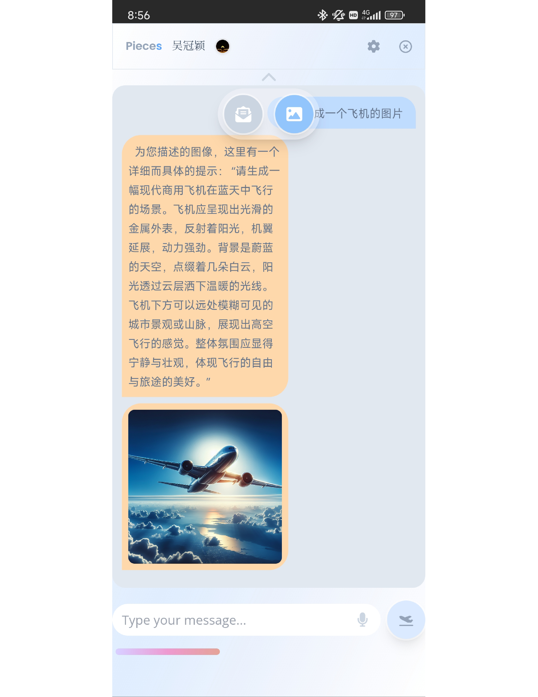
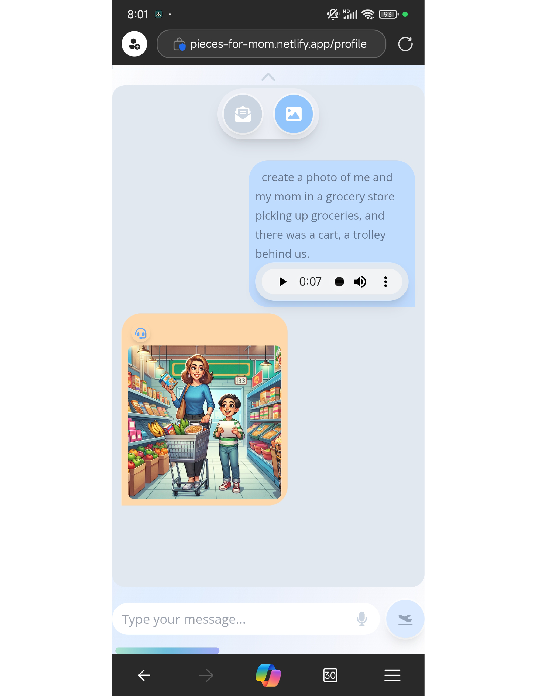

### Mom's AI Legacy — A Multimodal RAG Chatbot (React + FastAPI)

This Chatbot project was created in loving memory of the most important person in my life—my mom, who passed away from glioblastoma (GBM) on a sunny July morning in 2024.

The project aims to recreate her unique way of speaking and preserve her voice and personality through AI. It is a full-stack Retrieval-Augmented Generation (RAG) web application built with React and FastAPI, featuring:

- **Conversational AI:** Engages in natural, context-aware conversations and emulates my mom’s distinctive conversational style.
- **Multimodal Document Analysis:** Supports text extraction and analysis from XLSX, DOC, CSV, and PDF files.
- **Image Understanding:** Enables AI-powered image interpretation and understanding.
- **Text-to-Image Generation:** Generates images from text prompts.
- **Voice Input:** Supports speech recognition for voice-based interactions.
- **Text-to-Speech (TTS):** Converts text into speech for a more natural and personal conversational experience.

## Project Documentation

[📄 View Full Architecture Documentation (PDF)](Example.pdf)
